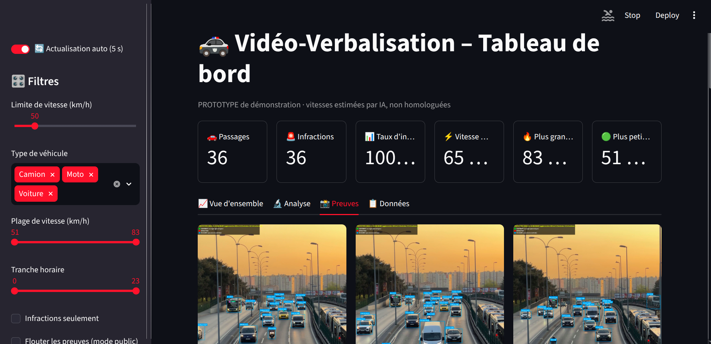
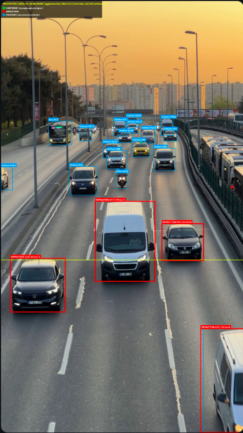
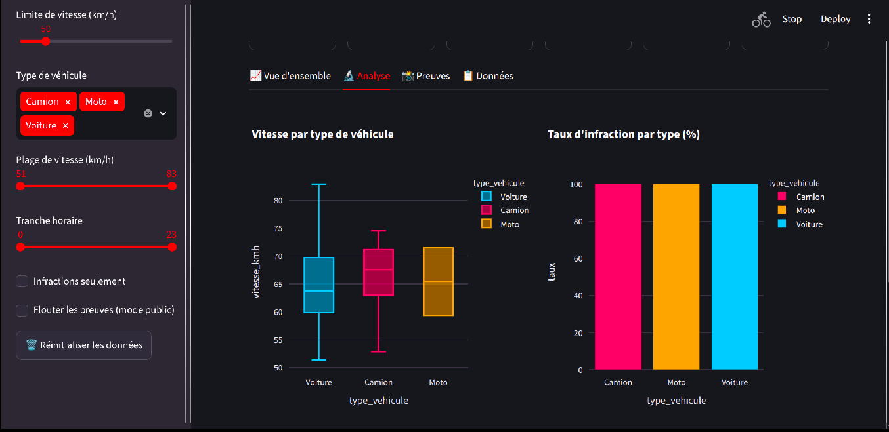
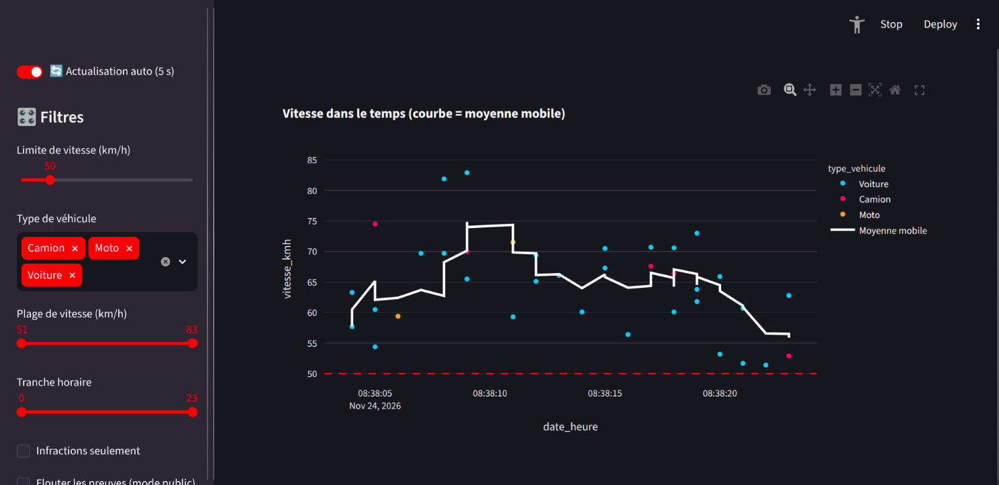

# 🚓 Vidéo-Verbalisation — prototype de détection d'excès de vitesse

> ⚠️ **PROTOTYPE DE TEST / DÉMONSTRATION.** Ce projet n'est ni homologué, ni certifié, et n'a **aucune valeur légale**.
> Les vitesses sont des **estimations** produites par vision par ordinateur à partir d'une vidéo.
> Il ne doit pas servir à verbaliser de vraies personnes.

### Lien de démo : https://app.videas.com/share/XrN3GSpdFSZUWO2qI7DaB3HrIjPAtwa8cJzd0cKtwUQ

Un système qui analyse une vidéo de circulation, suit chaque véhicule, estime sa vitesse, juge chaque véhicule **une seule fois**
lorsqu'il franchit une ligne de contrôle, puis affiche les résultats dans un tableau de bord.
## Aperçu

| Tableau de bord | Capture d'une infraction |
|:---:|:---:|
|  |  |

| Répartition des vitesses | Données |
|:---:|:---:|
|  |  |

| Vitesse et taux d'infraction | Vitesse |
|:---:|:---:|
|  |  |

Sur les captures et la vidéo annotée :
🟥 **rouge** = infraction · 🟩 **vert** = en règle après la ligne · 🟦 **bleu** = pas encore contrôlé · 🟨 **jaune** = ligne de contrôle.
## Comment ça marche

```
Vidéo ──► YOLO26 (détection) ──► ByteTrack (suivi, ID par véhicule)
                                      │
                    vitesse lissée (pixels → mètres → km/h)
                                      │
            franchissement de la ligne jaune → décision unique
                      │                              │
              en règle (vert)                 infraction (rouge)
                      │                              │ photo + lecture de plaque (OCR)
                      └────────────┬─────────────────┘
                                   ▼
                       API FastAPI + base SQLite
                                   ▼
                       Dashboard Streamlit (filtres, graphes)
```

- **Détection / suivi** : YOLO26 (Ultralytics) + ByteTrack, classes voiture, moto, bus, camion.
- **Vitesse** : déplacement du point bas du véhicule sur les ~20 dernières images, converti avec `PIXELS_PAR_METRE`, puis **médiane** des dernières mesures.
- **Décision** : une seule fois par véhicule, au franchissement de la ligne. La limite dépend du type de route (`agglomeration` 50, `route_secondaire` 80, `route_nationale` 100, `voie_rapide` 120 km/h, modifiables).
- **Preuve** : image complète au moment du franchissement (véhicules en règle en vert, infractions en rouge) + OCR Tesseract de la plaque.
- **Dashboard** : filtres (limite, type, vitesse, heure), indicateurs, histogramme, courbe de vitesse, passages par heure, galerie de preuves (floutage possible), export CSV.

## Installation (Ubuntu / Linux)

```bash
sudo apt install tesseract-ocr          # nécessaire pour la lecture de plaques
python3 -m venv venv && source venv/bin/activate
pip install -r requirements.txt
```

Place ta vidéo de test dans le dossier et règle `VIDEO` en haut de `app_engine.py`.

## Lancement (3 terminaux, dans cet ordre)

```bash
uvicorn server:app --port 8008          # 1. API + base de données
streamlit run dashboard.py              # 2. tableau de bord (http://localhost:8501)
python3 app_engine.py                   # 3. analyse de la vidéo
```

Le moteur écrit aussi **`demo_annotee.mp4`** (vidéo finale annotée) et enregistre les preuves dans `captures/`.

## Réglages importants (haut de `app_engine.py`)

| Réglage | Rôle |
|---|---|
| `TYPE_ROUTE` | Limite de vitesse appliquée (agglomération, route secondaire, nationale, voie rapide) |
| `PIXELS_PAR_METRE` | **Calibration** : le réglage le plus important pour des vitesses justes |
| `LIGNE_Y_RATIO` | Position de la ligne de contrôle (0 = haut de l'image, 1 = bas) |
| `MODELE`, `IMGSZ`, `SAUT` | Précision vs vitesse (`yolo26x` + 960 + toutes les images = précis mais lent sur CPU) |
| `ENVOYER_CONFORMES` | Compter aussi les véhicules en règle dans les statistiques (sans photo) |

**Calibrer `PIXELS_PAR_METRE`** : mesure en pixels, sur une image de la vidéo, une distance réelle connue (écart entre deux
repères au sol, ou largeur d'une voiture ≈ 1,8 m), puis divise les pixels par les mètres. Lance ensuite et vérifie que les
vitesses affichées sont plausibles. Une valeur trop basse fait apparaître presque tous les véhicules en infraction.

## Résultats et vérification

Les résultats ont été **vérifiés manuellement par l'auteur sur sa vidéo de test** (cohérence visuelle des vitesses et des
décisions). Ils n'ont **pas** fait l'objet d'une validation formelle : aucune comparaison avec une vitesse de référence
(radar, GPS, chronométrage), donc aucune erreur moyenne mesurée.

## Limites connues

- Une seule valeur de calibration par vidéo : la perspective rend la mesure approximative (une homographie serait plus juste).
- Caméra fixe nécessaire, avec une route bien visible.
- Lecture de plaque faible (Tesseract) : le résultat est souvent `INCONNUE`.
- Un véhicule qui ne franchit pas la ligne de contrôle (ou trop peu mesuré) n'est pas jugé.
- Changements d'identifiant possibles quand deux véhicules se croisent ou se masquent.
- Lent sur CPU avec le modèle le plus précis.

## Vie privée

Les vidéos de circulation et les images de plaques sont des **données personnelles**. Ce dépôt ne contient ni vidéo, ni
capture, ni base de données (voir `.gitignore`). Utilise l'option « Flouter les preuves » du dashboard avant toute démonstration
publique, et ne publie pas d'images où des personnes ou des plaques sont identifiables.

## Pistes d'amélioration

- Calibration par homographie (4 points de référence sur la route).
- Détecteur de plaques entraîné sur des plaques béninoises + OCR dédié (PaddleOCR / EasyOCR).
- Validation sur un jeu de données avec vitesses réelles (ex. BrnoCompSpeed).
- Export ONNX / TensorRT pour tourner sur un petit boîtier.

## Licence

Ce projet utilise [Ultralytics](https://github.com/ultralytics/ultralytics), distribué sous licence **AGPL-3.0** ; ce dépôt est
donc publié sous **AGPL-3.0**.

## Auteur

Amen Quenum
